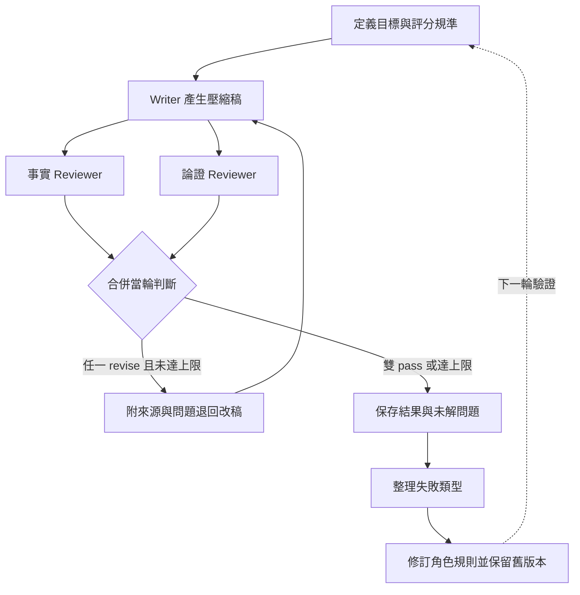
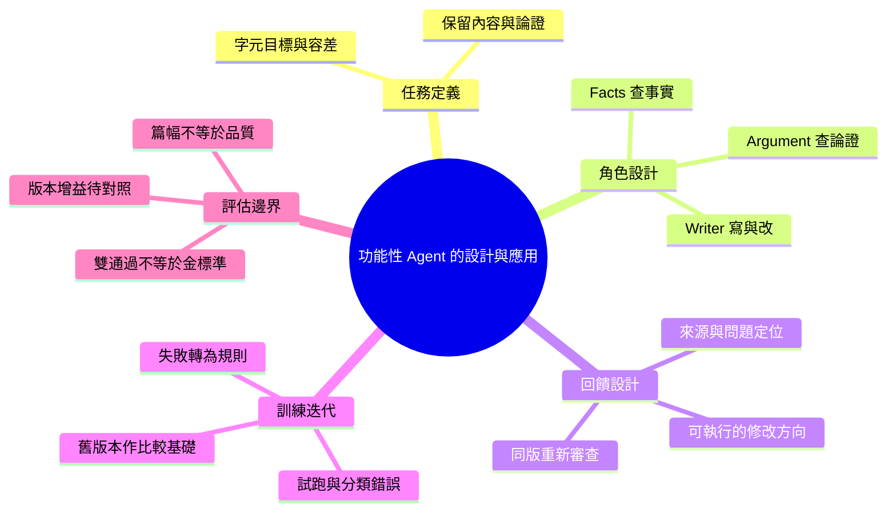

# 功能性 Agent 的設計與應用

**如何把一項工作需求，做成職責明確、能接受審查與持續改進的 AI Agent？**

本專案以「文件壓縮」為應用案例，展示從任務定義、角色設定、審查回饋到規則迭代的設計過程。寫作 Agent 負責產出與修改，兩位審查 Agent 分別檢查事實及論證；執行中的錯誤再整理成下一版角色規則。

## Agent 如何設計與改進？

| 設計步驟 | 在文件壓縮案例中的做法 |
|---|---|
| 定義任務與交付 | 縮短篇幅，同時保留數字意義、適用條件與論證 |
| 設定角色與邊界 | 寫手負責改稿；審查者對照原文，指出問題與修改方向 |
| 設計協作流程 | 兩位審查者檢查同版稿件；有問題就退回，達上限則保留未解問題 |
| 從失敗修訂規則 | 將遺漏條件、過度推論等錯誤，轉成具體行為要求 |
| 試跑與檢查 | 保存稿件、審查意見及版本，檢查流程是否依設定執行 |

這裡的「訓練」指角色、提示詞與工作流程的調整，沒有進行模型權重微調。目前已有角色設計案例、Python 流程控制、固定資料示範與單篇實際 Agent 試跑；尚未完成新舊規則的成效對照。

## 應用案例：文件壓縮

| 輸入 | 處理 | 輸出 |
|---|---|---|
| 原文、目標保留比例、角色規則 | 寫稿 → 事實與論證審查 → 必要時改稿 | 摘要候選稿、每輪修改意見、通過或未解決狀態 |

既有單篇實測：19,377 字元的工程文章縮為 13,143 字元，兩位 reviewer 在同一輪通過。[實測報告](docs/experiments/2026-10-08-openai-harness.md)保留方法與限制；這個結果不代表所有文章都能保真縮減。

## 一個案例：補回論證，卻寫得太肯定

以下根據第一篇文獻的歷史審查紀錄整理，並非本次重新執行：

| 步驟 | 發生什麼事 | 對 agent 設計的意義 |
|---|---|---|
| 第一稿 | 壓縮時弱化了不同實驗條件下的效果差異；論證 reviewer 要求補回對比 | 「不要失真」需要拆成可檢查項，例如保留對比兩側與適用條件 |
| 第二稿 | writer 補回關係，卻使用了過度確定的措辭；事實 reviewer 要求修正 | 修復一種錯誤可能引入另一種錯誤，改稿必須重新審查 |
| 第三稿 | 改用較中性的描述；紀錄中兩位 reviewer 都通過 | 通過是這一輪的審查結果，不等於客觀無誤 |
| 規則迭代 | v2 將「保留條件對比」「不新增強調或定論語氣」列為具案例來源的規則 | 將單次回饋整理成下次可使用、可追查的行為要求 |

另一例是保留了 IC50 數值，卻刪掉它代表的抑制比例。這促成更具體的規則：**量化資訊要保留數字及判據意義。**

[完整設計、訓練步驟與案例依據](docs/agent-design-training.md)

## 三個角色如何分工？

| 角色 | 任務 | 回傳什麼 |
|---|---|---|
| Writer／壓縮寫手 | 規劃保留內容、壓縮、依問題修訂；原始資料只讀 | 稿件、篇幅資料與修訂說明；v2 另要求計畫摘要及不確定處 |
| Facts reviewer／事實審查 | 對照數字、實體、條件、否定與新增內容 | pass 或 revise；有問題就附來源位置與修改方向 |
| Argument reviewer／論證審查 | 檢查因果、概念區分、主張與證據、限定範圍 | pass 或 revise；指出斷裂的論證與修復方向 |

編排者負責派工、合併回饋與停止條件。兩位 reviewer 分開接收原文與同版稿件，不取得彼此意見或 writer 自評；任何一位要求修訂都退回。這是輸入隔離，不保證判斷沒有共同偏誤。

## 訓練方式：改稿與改規則是兩個迴圈



**改稿迴圈**解決這篇文章的問題；**規則迭代**由 Nio 提出改進方向，Claude 回看實驗紀錄、提案並修改角色設定。現有 Python runtime 執行前者，沒有自動訓練或改寫角色規則。

## 從 v1 到 v2 改了什麼？

- **步驟明確化**：規劃 → 改寫 → 機械檢查 → 交付；以計畫摘要供回看。
- **規則分層**：核心原則、附案例來源的失敗防範規則、格式與字元檢查。
- **保留研究空間**：保存 v1、標記規則來源，讓後續能比較加入或移除規則的結果；對照實驗尚未完成。



## 已有成果與能支持的結論

| 材料 | 已有結果 | 證據範圍 |
|---|---|---|
| 十篇生醫文獻歷史實驗 | 留有稿件、審查與修訂紀錄；失敗被整理為 v2 規則 | 支持方法演進的案例；部分歷史字數與審查版本不一致 |
| 一篇工程文章的 Codex 移植 | 19,377 → 13,143 字元，1 輪雙審通過 | 支持本次角色方法能跨平台執行；無控制組，不能歸因於特定規則 |
| Python 流程 | 保存每輪稿件、綁定審查版本與控制停止條件 | 支持執行可追溯，不替代語意品質評估 |

## 快速開始：先看審查與修訂怎麼運作

需要 Python 3.10+。在 repo 根目錄執行，不需要 API key：

```sh
python3 runtime/demo.py runs/demo-01
```

這個示範使用固定測試資料，**沒有呼叫模型**：第一輪遺漏條件，收到修改意見後，第二輪通過。查看輸出目錄中的 `candidate.md`（最後稿件）和 `run.json`（執行結果），預期為 `review_pass`、兩輪。每輪的稿件及 reviewer 意見也會保存。

要接實際模型，需另行配置轉接器，詳見[執行與模型連接方式](docs/runtime-guide.md)。

## 技術棧與深入閱讀

| English | 中文 | 用途 |
|---|---|---|
| Agent instructions | 角色規則 | 定義職責、輸入輸出與評分規準 |
| Claude Code / Codex agents | 代理執行環境 | 歷史實驗與後續方法移植；兩者結果分開記錄 |
| Python / JSON | 流程控制與資料契約 | 派工轉接、合併審查與保存狀態 |
| Markdown / Mermaid | 文件與圖表 | 呈現角色設計、訓練案例與流程 |

- [Agent 設計與訓練案例](docs/agent-design-training.md)
- [跨主題移植實測](docs/experiments/2026-10-08-openai-harness.md)
- [歷史資料核對](docs/historical-audit.json)
- [執行方式、完整流程與驗證範圍](docs/runtime-guide.md)

原始私人對話、完整稿件與角色原檔留在本機；repo 提供方法整理、案例摘要與程式。不同 adapter 使用的提示不完全相同，不能把所有執行都當作同一版 agent 的成效。

Author: Nio (Master) · Evidence review and editing: Codex · 2026-10-17
