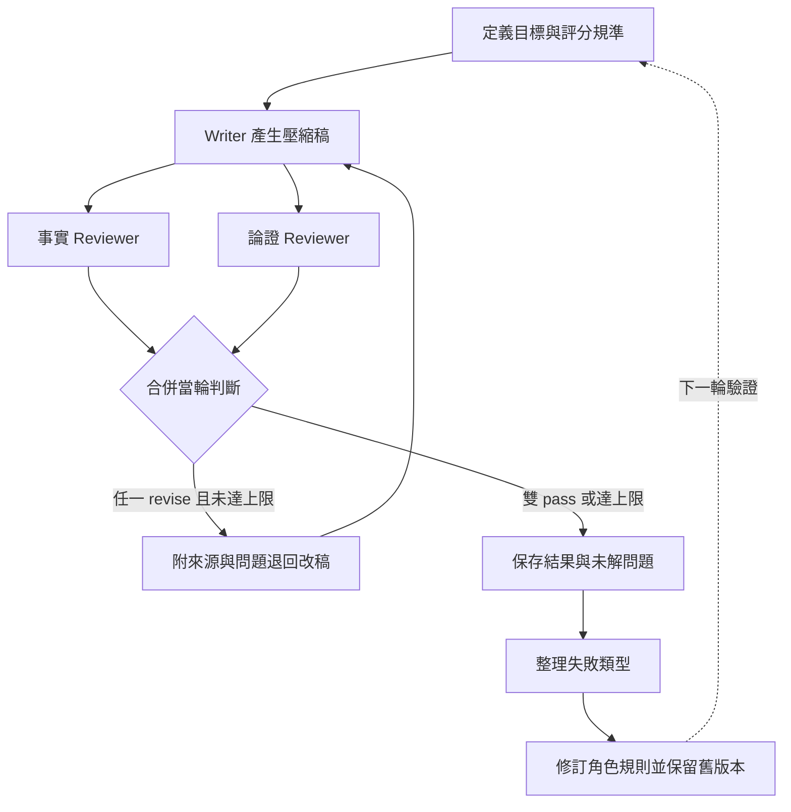
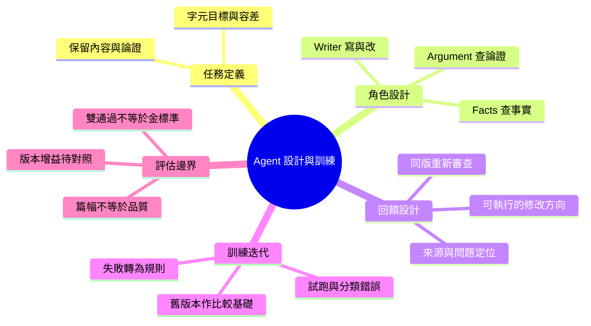

# 壓縮大師：Agent 設計與訓練案例

**用實際壓縮錯誤改進 agent：讓 writer 寫稿，兩位 reviewer 分別查事實與論證，再把失敗整理成下一版規則。**

應用情境是長文閱讀：希望篇幅縮短，又保留數字的意義、因果條件與作者的論證。本專案以文件壓縮為實驗任務，展示如何定義 agent 職責、設計審查回饋，以及迭代角色規則。

這裡的「訓練」是**角色、提示詞、評分規準與工作流程的校正**，未進行模型權重微調。已有歷史試跑及一次跨主題移植實測；尚未證明 v2 比 v1 更有效。

## 一個案例：補回論證，卻寫得太肯定

以下根據第一篇文獻的歷史審查紀錄整理，並非本次重新執行：

| 步驟 | 發生什麼事 | 對 agent 設計的意義 |
|---|---|---|
| 第一稿 | 壓縮時弱化了不同實驗條件下的效果差異；論證 reviewer 要求補回對比 | 「不要失真」需要拆成可檢查項，例如保留對比兩側與適用條件 |
| 第二稿 | writer 補回關係，卻使用了過度確定的措辭；事實 reviewer 要求修正 | 修復一種錯誤可能引入另一種錯誤，改稿必須重新審查 |
| 第三稿 | 改用較中性的描述；紀錄中兩位 reviewer 都通過 | 通過是這一輪的審查結果，不等於客觀無誤 |
| 規則迭代 | v2 將「保留條件對比」「不新增強調或定論語氣」列為具案例來源的規則 | 將單次回饋整理成下次可使用、可追查的行為要求 |

另一例是保留了 IC50 數值，卻刪掉它代表的抑制比例。這促成更具體的規則：**量化資訊要保留數字及判據意義。**

[完整設計、訓練步驟與案例依據](docs/agent-design-training.md)

## 三個角色如何分工？

| 角色 | 任務 | 回傳什麼 |
|---|---|---|
| Writer／壓縮寫手 | 規劃保留內容、壓縮、依問題修訂；原始資料只讀 | 稿件、篇幅資料與修訂說明；v2 另要求計畫摘要及不確定處 |
| Facts reviewer／事實審查 | 對照數字、實體、條件、否定與新增內容 | pass 或 revise；有問題就附來源位置與修改方向 |
| Argument reviewer／論證審查 | 檢查因果、概念區分、主張與證據、限定範圍 | pass 或 revise；指出斷裂的論證與修復方向 |

編排者負責派工、合併回饋與停止條件。兩位 reviewer 分開接收原文與同版稿件，不取得彼此意見或 writer 自評；任何一位要求修訂都退回。這是輸入隔離，不保證判斷沒有共同偏誤。

## 訓練方式：改稿與改規則是兩個迴圈

**改稿迴圈**解決這篇文章的問題；**規則迭代**由人與 agent 回看實驗紀錄後進行，將可重用的教訓寫入角色設定。現有 Python runtime 執行前者，沒有自動訓練或改寫角色規則。

## 從 v1 到 v2 改了什麼？

- **步驟明確化**：規劃 → 改寫 → 機械檢查 → 交付；以計畫摘要供回看。
- **規則分層**：核心原則、附案例來源的失敗防範規則、格式與字元檢查。
- **保留研究空間**：保存 v1、標記規則來源，讓後續能比較加入或移除規則的結果；對照實驗尚未完成。

## 已有成果與能支持的結論

| 材料 | 已有結果 | 證據範圍 |
|---|---|---|
| 十篇生醫文獻歷史實驗 | 留有稿件、審查與修訂紀錄；失敗被整理為 v2 規則 | 支持方法演進的案例；部分歷史字數與審查版本不一致 |
| 一篇工程文章的 Codex 移植 | 19,377 → 13,143 字元，1 輪雙審通過 | 支持本次角色方法能跨平台執行；無控制組，不能歸因於特定規則 |
| Python 流程 | 保存每輪稿件、綁定審查版本與控制停止條件 | 支持執行可追溯，不替代語意品質評估 |

Nio 定義壓縮目標、指定 writer 與雙 reviewer 分工、要求記錄修訂，並將工作推進為可反覆實證的 agent 訓練 lab。Claude 協作建立角色與歷史實驗，Codex 協作核對紀錄、移植執行與工程化。

## 技術棧與深入閱讀

| English | 中文 | 用途 |
|---|---|---|
| Agent instructions | 角色規則 | 定義職責、輸入輸出與評分規準 |
| Claude Code / Codex agents | 代理執行環境 | 歷史實驗與後續方法移植；兩者結果分開記錄 |
| Python / JSON | 流程控制與資料契約 | 派工轉接、合併審查與保存狀態 |
| SHA-256 | 稿件指紋 | 防止沿用其他版本的審查結果 |
| Markdown / Mermaid | 文件與圖表 | 呈現角色設計、訓練案例與流程 |

- [Agent 設計與訓練案例](docs/agent-design-training.md)
- [跨主題移植實測](docs/experiments/2026-10-08-openai-harness.md)
- [歷史資料核對](docs/historical-audit.json)
- [執行方式、完整流程與驗證範圍](docs/runtime-guide.md)

原始私人對話、完整稿件與角色原檔留在本機；repo 提供方法整理、案例摘要與程式。不同 adapter 使用的提示不完全相同，不能把所有執行都當作同一版 agent 的成效。

Author: Nio (Master) · Evidence review and editing: Codex · 2026-10-14
