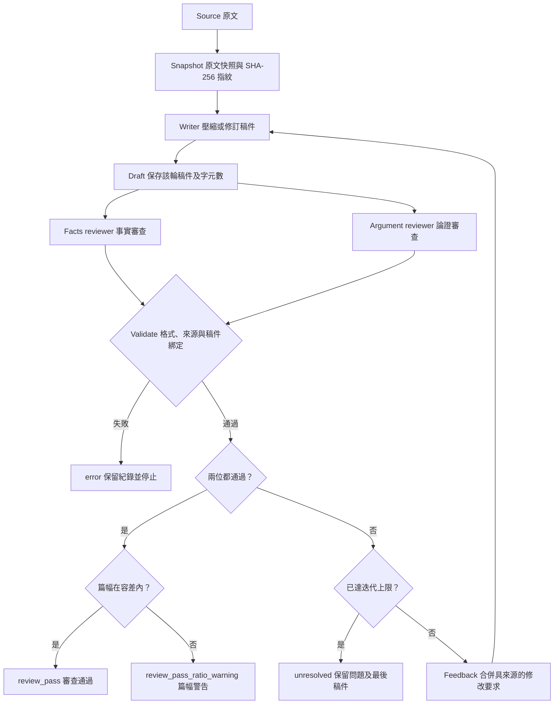
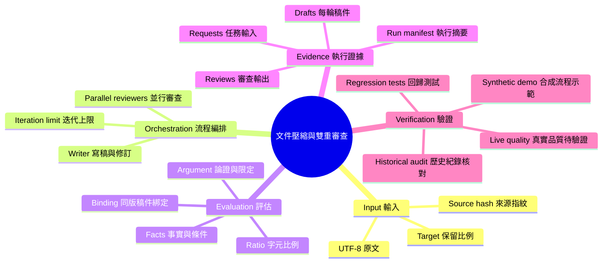

# Document Compression Lab｜長文壓縮與雙重審查

把長文壓縮成較短的文件，並保存「哪一版稿件、由誰審查、提出什麼問題、為什麼停止」的完整執行紀錄。

**狀態：本機 v0.1。** macOS／Linux 上的 Python 執行流程、合成示範與回歸測試已實作；已完成一篇 Codex agents 實測，尚無人工金標準或跨文章成效結論。既有十篇文獻是歷史實驗，不代表新版成效。

作者：Nio (Master)。原始任務設計與實驗來自 Nio 與 Claude Code 的協作；本版 Python 工程化由 Codex 協作完成。此處「訓練」指角色、提示詞、評分規準與修正流程的校正，未進行模型權重微調。

## 要解決的問題

篇幅變短容易量測，內容是否失真卻不能只看字數。原有實驗曾在補回因果論述後，出現原文沒有的強調語氣；另一份紀錄則把前一版 reviewer 的通過結果沿用到修改後的稿件。

本專案的目標是建立**可重跑、可追溯的壓縮審查流程**。它讓不同 reviewer 分別檢查事實與論證，並將每次判斷綁定到實際稿件。兩位 reviewer 同意不代表客觀無誤，仍需人工標準與獨立資料驗證。

## 流程圖｜Execution flow



兩位 reviewer 作為獨立任務並行執行，只收到同一份原文與當輪稿件，不取得彼此的意見或 writer 的自評。使用 handoff 時，Codex agents 由主線派工，Python 子程序只負責轉接與等待。這是輸入隔離，不保證模型之間沒有共同偏誤。圖中所有節點都對應 [core.py](runtime/core.py) 的實作。

## 心智圖｜Responsibility map



## 技術棧｜Technology stack

| English | 中文對照 | 在本專案的用途 | 狀態 |
|---|---|---|---|
| Python 3.10+ | Python 執行環境 | CLI、流程控制與資料驗證，使用標準函式庫 | 已實作 |
| ThreadPoolExecutor | 執行緒池 | 同時派出兩份審查工作 | 已測試 |
| subprocess / argv | 子程序／參數陣列 | 接任意遵守 JSON 契約的模型轉接器，不使用 shell 字串執行 | 已測試 |
| JSON protocol | 結構化資料契約 | 傳遞稿件、審查意見與狀態 | 已實作 |
| SHA-256 | 雜湊指紋 | 原文及稿件版本綁定；不等於防偽簽章或內容正確性 | 已測試 |
| Chat Completions adapter | 對話 API 轉接器 | 選配模型連線，使用 model/messages 基本格式 | 本機 HTTP 契約測試；真實供應商待測 |
| unittest | 自動化測試框架 | 停止條件、舊 verdict、錯誤、併行與輸入隔離 | 已測試 |
| Mermaid | 文字式圖表 | GitHub 可編輯的流程圖與心智圖 | 已加入 |
| Codex subagents / File handoff | 分工代理／檔案交接 | 移植既有角色規準，由主線派工、Python 驗證 | 單篇實測完成 |
| Claude Code / Sonnet / Haiku | 歷史代理執行平台與模型 | 原有十篇實驗的 writer／reviewer 分工 | 歷史資料，非新版預設依賴 |

## 五分鐘試跑：不需要 API key

在此專案目錄執行：

```bash
python3 runtime/demo.py runs/demo-01
python3 -m unittest discover -s tests -v
```

示範是**固定的合成測試資料**：第一輪刻意遺漏條件並過度推論，兩位 reviewer 要求修訂，第二輪通過。它確實執行子程序和審查迴圈，但沒有呼叫 LLM，不能用來宣稱模型壓縮品質。

預期摘要：`status=review_pass`、`rounds=2`、`execution_kind=synthetic`。重跑請使用新的輸出目錄，以免覆寫證據。

產物包含 `source.md`、各輪 `draft.md`、writer 與 reviewer 的 request/response、`candidate.md` 及 `run.json`。`candidate.md` 也可能是未通過的最後一稿，必須一起看 `run.json`。

## 接上模型

內附 [HTTP adapter](runtime/http_adapter.py)，以環境變數設定完整 API endpoint 與三個角色的模型：

- `COMPRESSION_API_URL`：完整 `/v1/chat/completions` URL。
- `COMPRESSION_MODEL_WRITER`、`COMPRESSION_MODEL_FACTS`、`COMPRESSION_MODEL_ARGUMENT`：由 endpoint 實際支援的 model ID。
- `COMPRESSION_API_KEY`：若供應商需要驗證，由環境提供，不寫進設定檔。

設定後，在專案目錄執行：

```bash
python3 runtime/cli.py your-document.md --out runs/live-01 \
  --config runtime/config.example.json --target 0.65 --max-iterations 5
```

API 收到的是原文全文。選擇雲端 endpoint 即代表資料會送往該供應商；本工具不替你載入金鑰、不啟動本機模型。轉接器使用 [Chat Completions 基本訊息與回應格式](https://developers.openai.com/api/reference/resources/chat)，不支援所有供應商特有欄位；模型需能輸出指定 JSON 並容納全文。截斷、非 JSON 或 API 錯誤皆停止，不把片段當完成稿。

也能用其他 CLI／API：只需提供三個可信的 command argv，遵守 [資料契約](docs/protocol.md)。角色可指定不同模型；相同模型的不同呼叫僅有輸入隔離，不代表認知獨立。

## 研究設計與已有結果

**背景與目標。** 2026 年 5 月從十篇腸腦軸文獻開始，原目標為保留 65% 字元（容差 ±3 個百分點），由事實與論證兩層 reviewer 檢查失真。

**方法。** 歷史實驗以 Claude Code skill 派工，依 reviewer 意見修改，再將失敗類型整理成 writer v2 的 guards。2026 年 10 月此版把執行與驗證規則落成 Python；它是新的工程化版本，沒有假稱原封重現歷史 v2 提示詞。

**結果。** 目前本機檔案合計 527,432 → 334,820 字元，保留 63.4812%，縮減 36.5188%。字元計算含 frontmatter、空白與換行；不是 token 節省率。加權總比率與各篇比率平均值不可混用。

**討論。** 歷史 review log 的十篇都標示 pass，但 02、08、10 有字數不一致；02 還沿用前輪其中一位 reviewer 的 verdict。逐條紀錄共 10 個 issue，舊彙總正文寫成 9 個。缺少逐輪稿件 hash，無法追認現在的檔案就是當年被審查的版本。

**結論。** 這批資料支持「曾執行壓縮、審查與修訂」以及「現存檔案有篇幅縮減」，尚不支持 100% 語意保真、v2 勝過 v1，或跨領域有效。詳見 [重新計算的核對結果](docs/historical-audit.json)。原稿、歷史紀錄與舊 metrics 保留在本機；不隨可攜程式包分享。

## 2026-10-08：既有 Claude 壓縮大師實測

沿用既有 Claude 壓縮大師與雙 reviewer 規準，由三個 Codex agents 實際執行。OpenAI 技術文章從 **19,377 縮至 13,143 字元（縮短 32.17%）**，兩位 reviewer 對同版稿件通過，完成 1 輪。這是單篇、無控制組的實測，不能當成普遍保真證據。詳見 [研究方法、結果與限制](docs/experiments/2026-10-08-openai-harness.md) 與 [結果 JSON](docs/experiments/2026-10-08-openai-harness-results.json)。

## 驗收與下一個實驗

- 已驗證：同版雙審查、單一 reviewer 否決、迭代上限、錯誤停止、歷史字數核對、子程序合成示範。
- 已完成實測：三個 Codex agents 處理一篇工程文章，1 輪雙審查通過。
- 待驗證：HTTP endpoint／模型相容性、多篇時延與成本、人工標註的失真率。
- 下一個品質實驗：在未參與提示詞校正的文件上，比較單次壓縮與雙 reviewer 迴圈；固定模型、文件與參數，人工評分限定詞、數字意義、論證關係，記錄成本及失敗。尚未執行，不預填成效。

[驗收範圍與變更說明](docs/validation.md) · [資料契約](docs/protocol.md)
