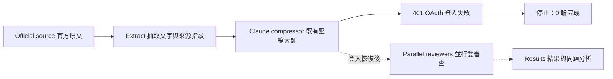

# OpenAI 2026 技術文章：Claude 壓縮大師實測

作者：Nio (Master) · 執行及報告：Codex · 日期：2026-10-08

**目前狀態：登入阻擋，未取得壓縮結果。** 這是實驗登錄與執行失敗紀錄，尚不是完成的品質報告。

## 研究背景與目標

既有十篇訓練材料集中於生醫主題。本次依 Nio 指示，選一篇 OpenAI 於 2026 年發布的 AI 技術文章，以既有 Claude 壓縮大師及兩種 reviewer 角色進行跨主題單篇測試。評估重點是篇幅縮減時，數字意義、因果與適用條件是否保留；單篇不能推論跨領域普遍有效。

## 材料與來源

- [Harness engineering: leveraging Codex in an agent-first world](https://openai.com/index/harness-engineering/)
- 發布：2026-02-11；作者：Ryan Lopopolo；出版者：OpenAI。
- 類型：工程經驗文章，非學術論文。
- 取得：2026-10-08，官方頁面可讀文字；排除導覽、頁尾、圖像與程式區塊行號，保留文章標題、正文、章節與目錄程式區塊。
- 實際輸入：19,377 Unicode 字元，含空白與換行。
- SHA-256：`fef68195ae2371054b1e57edcebfb1bc0c5abaa10bf3dd7ef2bbf4c896059ec4`。

原文全文、抽取快照、角色設定快照、請求與回應保存在本機 Git-ignored `runs/`，不隨報告上傳。

## 材料與方法

| Role | 中文 | 實際載入的既有設定 | 指定模型別名 |
|---|---|---|---|
| Writer | 壓縮大師 | compressor.md | sonnet |
| Facts reviewer | 事實審查 | compression-reviewer-haiku.md | haiku |
| Argument reviewer | 論證審查 | compression-reviewer-sonnet.md | sonnet |

Claude Code 版本 2.1.175。使用者既有角色文件正文載入 system prompt，原始檔保存 hash；模型別名不等於確定的模型版本，須待成功回應的 modelUsage 記錄才能確認。

**介面調整必須揭露：** 本版透過 `claude_adapter.py` 執行角色，將原本檔案讀寫／YAML 改成完整文章 inline 輸入與 JSON schema 輸出；停用工具，由 Python 保存檔案、計算篇幅及綁定稿件。這保留角色規準，並非完全原樣重跑 Claude skill。沒有修改使用者的全域角色或 skill。原 skill 的額外篇幅 retry 尚未移植，此 run 使用最多五個正式迭代。

設定：保留 65% 字元，容差 ±3 個百分點，最多五輪。兩位 reviewer 同輪並行，每輪都審查當輪同一稿件，任一要求修訂即退回；格式／驗證／模型失敗即停止。

## 結果

| 指標 | 實測 |
|---|---|
| 原文準備 | 完成 |
| 壓縮呼叫 | 1 次，writer 階段失敗 |
| 最小登入診斷 | 1 次，確認 401 OAuth access token is invalid |
| 完成輪次 | 0 |
| 壓縮字元數、比例 | 未取得 |
| 雙 reviewer 判斷 | 尚未執行 |
| 模型品質、時延與費用 | 本輪不可評估 |

CLI 的 auth status 顯示已登入，但實際推論請求拒絕驗證。這表示本機登入狀態不等於 token 仍可用。沒有改用 Codex 冒充 Claude 結果，也沒有將流程單元測試當成文章壓縮成效。

## 討論與後續判準

需由使用者重新登入 Claude Code 才能完成指定模型的測試。恢復後會使用同一來源指紋、角色快照與參數，建立新 run，保留本次失敗紀錄。

正式品質報告將區分初稿／修訂稿、reviewer 提出的問題、修訂副作用、原文限定條件抽查與執行成本；只陳述實際取得的結果。事先登錄的十項抽查涵蓋估計與事實的區分、數量關係、原因、知識分工、架構限制、合併策略適用條件、自主性前提、清理機制、長期未知與章節秩序；這不是完整人工 gold set。

## 結論

來源與執行介面已準備，Claude OAuth 失效阻止 writer 推論。本次尚不能判斷壓縮大師在此文章上的效果。
