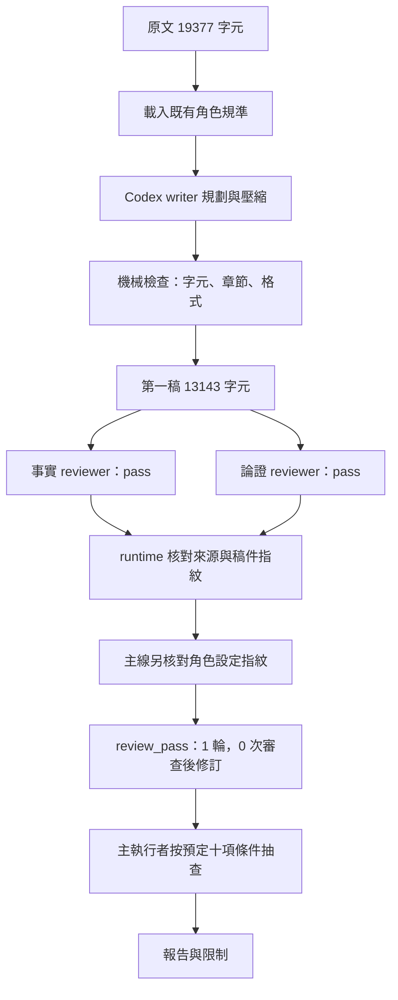
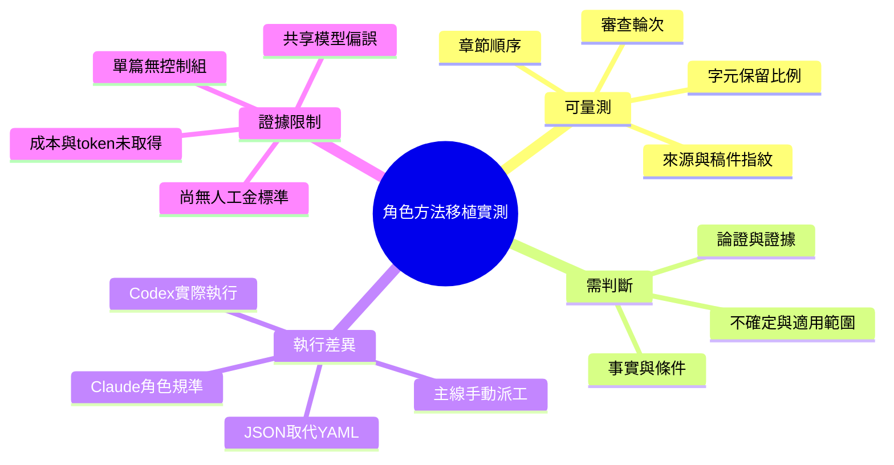

# 既有壓縮角色移植到 Codex：OpenAI 技術文章實測

作者：Nio (Master) · 執行與報告：Codex · 日期：2026-10-08

**結果：19,377 → 13,143 字元，縮短 32.17%；同版稿件的事實與論證 reviewer 均通過。** 這是一次實際 agent 執行，非固定答案的合成示範。只有一篇文章，尚不能推論普遍保真或某模型優於另一模型。

[可核對的結果 JSON](2026-10-08-openai-harness-results.json) · [流程實作](../../runtime/core.py) · [對話代理交接介面](../../runtime/handoff_adapter.py)

## 研究背景

既有實驗使用 Claude 的壓縮大師，並以兩個角色分別審查事實與論證。歷史資料集中於生醫文章；本次改用工程文章，觀察既有角色規準能否在不同執行平台與主題上運作。

Nio 指定沿用既有 agent 設定的方法，由 Codex 執行即可。因此本次保留角色分工、壓縮規準與修訂迴圈，解除對 Claude CLI 的依賴；不是重新訓練模型權重，也沒有聲稱精確重現當年的 Claude 行為。

## 研究目標與驗收

1. 完成一次實際壓縮與同版雙 reviewer 審查，保存可追溯的輸入與輸出。
2. 目標保留 65% 字元，容差 ±3 個百分點，即 62–68%。
3. 兩個 reviewer 任一要求修改，就回到 writer；最多五輪，不沿用舊版通過結果。
4. 額外核對事先選定的十項內容條件；不將字元縮減當成語意完整性的替代指標。

## 文章與選材理由

材料是 OpenAI 的 [Harness engineering: leveraging Codex in an agent-first world](https://openai.com/index/harness-engineering/)，Ryan Lopopolo 撰寫，2026-02-11 發布。它是工程經驗文章，並非學術論文。

文章包含量化敘述、流程、架構限制及尚未解決的問題，適合檢查壓縮是否留下條件與不確定性；主題也與本專案的 agent 編排直接相關。它不是訓練資料未見測試：本次未用該文章調整角色規準，但無法證明模型預訓練從未接觸它。

## 材料與方法

### 輸入固定方式

2026-10-08 擷取官方頁面可讀正文，保留文章標題、章節、文字與目錄程式區塊；排除導覽、頁尾、圖像、網頁引用包裝與程式碼行號。輸入共 **19,377 Unicode 字元**，含空白、標點與換行。

原文 SHA-256：`fef68195ae2371054b1e57edcebfb1bc0c5abaa10bf3dd7ef2bbf4c896059ec4`。本次只測文字，不評估被排除圖像的資訊保留。

### 角色來源與平台調整

| Role | 中文對照 | 沿用的既有設定 | 本次執行 |
|---|---|---|---|
| Writer | 壓縮大師 | compressor.md v2 | Codex writer agent |
| Facts reviewer | 事實審查 | compression-reviewer-haiku.md | 獨立 Codex agent |
| Argument reviewer | 論證審查 | compression-reviewer-sonnet.md | 獨立 Codex agent |

三份來源設定皆保存快照與 SHA-256，執行回覆的設定指紋已由主線額外核對一致；通用 runtime 強制驗證的是來源、輪次與稿件指紋，尚未強制驗證角色設定指紋。檔名中的 Haiku／Sonnet 表示原角色的歷史設定，**不代表本次呼叫了這些模型**。本次工具未回傳每個 agent 的精確模型 ID、token 用量或計費數據，因此不填估計值。

writer 依規劃篇幅、壓縮、機械檢查、交付四階段處理；保留英文、原章節順序與必要條件。輸出正文不加 frontmatter，計數、角色指紋及自承不確定另存 JSON。生醫例子只作規則示意，沒有套進工程文章。

兩位 reviewer 使用新建且不繼承對話歷史的 session，同時收到原文與同版稿件，不收到 writer 自評、另一位 reviewer 的意見或既有結論。這是派工與輸入隔離；檔案系統仍共享，並非安全沙箱，也不是不同模型之間的認知獨立。

### 實際流程圖

### 評估心智圖

### 技術棧對照

| English | 中文 | 作用 |
|---|---|---|
| Codex subagents | 分工代理 | 一位 writer、兩位新建 reviewer |
| Python runtime | 流程控制程式 | 雙審查、迭代上限、狀態保存 |
| File handoff | 檔案交接 | 接 agent 真實輸出，不需 Claude 登入或另加 API key |
| Atomic JSON write | 原子寫入 | 避免讀到尚未寫完的回覆 |
| SHA-256 binding | 指紋綁定 | 核對原文、設定與稿件版本 |
| Mermaid | 文字式圖表 | 流程與評估結構 |

主線負責派工並接回結果；runtime 自動保存與驗證。這次不是無人值守的 agent 排程器測試。

## 結果

| 指標 | 實測值 |
|---|---:|
| 原文 | 19,377 字元 |
| 第一稿／最終稿 | 13,143 字元 |
| 減少字元 | 6,234 |
| 保留比例 | 67.8278% |
| 縮減比例 | 32.1722% |
| 62–68% 容差 | 達標 |
| 二級章節 | 11 個，順序一致 |
| 完成正式輪次 | 1 |
| 審查後修訂 | 0 |
| 事實 reviewer | pass，0 個 issue |
| 論證 reviewer | pass，0 個 issue |
| runtime 狀態 | review_pass |

writer 在交付前可自行依機械檢查調整；「0 次修訂」指沒有 reviewer 退回後的修訂，不代表寫稿中沒有改字。

最終稿 SHA-256 與兩份 reviewer 回應的指紋一致，值記錄於結果 JSON。完整稿件及模型工作紀錄留在本機，不在 GitHub 轉載原文或大幅壓縮轉述。

### 事先登錄的內容抽查

主執行者按預先登錄條件對照原文與最終稿：估計／事實區分、數量關係、原因、知識分工、架構限制、合併條件、自主性前提、清理機制、長期未知及章節秩序，十項未辨識出缺失。

這是 Codex 的定向檢查，不是人工 gold set、逐句完整評分或客觀「100% 保真」。它與雙 reviewer 的判斷可能有共同盲點。

## 討論

**這次能支持的結論。** 既有角色規準可以在本次 Codex session 中執行，並通過這篇文章的篇幅、結構及雙 reviewer 判準。原先卡住的 Claude 登入不是移植方法所必需的條件。

**這次不能支持的結論。** 沒有不使用角色設定的對照組，也沒有單 reviewer／無 reviewer 的比較，無法把通過歸因於 v2 guards，更不能宣稱 Codex 優於 Claude。兩位 reviewer 都沒有報 issue，所以本次也沒有新增「修訂迴圈改善品質」的實證；迴圈分支目前由自動化測試與過往實驗紀錄支持。

**值得保留的觀察。** 最終保留比例靠近容差上緣，表示結果更接近保留 68%，而不是精準保留 65%。兩位 reviewer 對此篇沒有要求修正，是一個單篇結果；不可據此降低後續審查強度。

**執行與成本限制。** 原文處理、派工與回覆等待都混在 wall time 中，不能將它報成模型推論速度。未取得 token／費用資料，字元減少也不等於省下相同比例的 token 或金額。

## 結論與下一個可驗證問題

本次完成一篇工程文章的角色移植實測：縮短 32.17%，同版雙審查通過，執行證據可追溯。下一個品質問題是：在多篇文件與人工標註下，這些角色規準是否比簡單壓縮指令更能保留條件、數字意義與論證。該比較尚未執行。

## 執行中斷紀錄

較早的 Claude CLI 嘗試因 OAuth 401 停止，完成 0 輪；後續第一次 Codex writer 因用量限制中斷，也未產稿。Nio 指示繼續後，保留這些失敗 run，另建本次完成 run；沒有將中斷計為品質迭代。原文與角色快照未變。本次 writer 先回到原交接 slot，主線驗證相同來源與參數後交給新 run 接收，並留下續跑紀錄。
